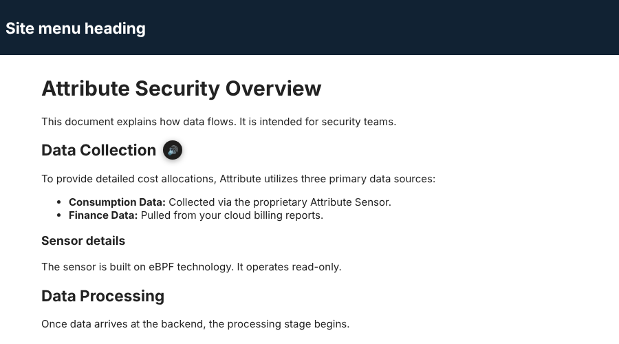

# Claude Read Aloud

A Chromium extension (Edge, Chrome, Brave…) that reads **Claude's replies and any web page** aloud, with the sentence being read and the current word highlighted so your attention stays on the text.

It uses the browser's own speech engine. It never calls Claude or any other AI, so **reading costs zero tokens**.



## Features

| | |
|---|---|
| **Section reading** | Hover a heading to get a 🔊 next to it. The title (H1) reads the whole article, a sub-heading reads just its chapter, up to the next heading of the same or higher level. |
| **Whole Claude reply** | On claude.ai, hovering a reply that has no headings shows a 🔊 that reads the whole reply. Optional **Auto** mode reads each new reply when it finishes. |
| **Selection reading** | Select any text and a **🔊 Read** button follows the selection. It stays on screen while you scroll and Shift+click to extend it. |
| **Live highlighting** | The sentence gets a soft tint and the current word gets a solid box. Colours are chosen automatically to contrast with each block's background (WCAG 4.5:1), or set manually. |
| **Player bar** | ⏮ / ⏭ move by sentence *within the current scope* (section, reply or selection). ⏸ resumes from the current word. Speed control, settings ⚙. |
| **Speed** | Presets from 0.75× to 3× plus a fine slider. Changes apply mid-sentence. |
| **Language detection** | Each section, and each long paragraph, is language-detected. French goes to a French (France) voice, English to your default voice, and other languages to the best Natural voice available. Shows an **EN / FR** badge while reading. |
| **Page chrome skipped** | Menus, site headers, footers, sidebars, forms and editable areas never get buttons and are never read. Code blocks are skipped (optional). |
| **Shortcuts** | `⌥⇧R` / `Alt+Shift+R` play/pause, `⌥⇧S` / `Alt+Shift+S` stop, `Esc` stop. Right-click → **Read aloud**. |
| **Per-site off switch** | From the toolbar popup or the settings panel. |

## Install (unpacked)

1. Download or clone this repo.
2. Open `edge://extensions` (or `chrome://extensions`).
3. Enable **Developer mode** (Edge: left sidebar, Chrome: top right).
4. Click **Load unpacked** and select the **`extension/`** folder.
5. Pin the extension (puzzle-piece icon), then refresh any open tabs.

To update, pull the repo, click the reload arrow on the extension card, and refresh your tabs.

To build a zip: `scripts/package.sh` writes `dist/claude-read-aloud-<version>.zip`.

## Recommended voices

Microsoft Edge exposes Microsoft's **Online (Natural)** neural voices to web pages, which sound far better than the local OS voices:

- English default: *Microsoft Christopher Online (Natural)*. It's the extension's default when present.
- French: *Denise* or *Henri Online (Natural) – French (France)*. Picked automatically, or pin one in ⚙ → French voice.
- *Multilingual* voices (e.g. Remy, Vivienne): if set as the default, they're kept for every language.

Chrome offers Google network voices instead. They don't report word positions, so word highlighting uses a timing estimate (see [How it works](docs/HOW-IT-WORKS.md#word-tracking)).

## Settings (⚙ in the player bar)

Voice, French voice, auto language detection · speed presets and slider · pitch · sentence and word highlight on/off · auto-contrast or manual colours (sentence colour and opacity, word background and text) with a live preview · scroll to follow along · heading buttons on/off and on all websites · per-site enable · auto-read Claude replies · skip code blocks · reset.

Settings are stored in `chrome.storage.local`, shared across tabs, and not synced.

## Privacy

- No servers, no analytics, no API keys. The extension never sends page content anywhere itself.
- **Online (Natural) voices** are synthesised by Microsoft (Edge) or Google (Chrome). The text being spoken is sent to that vendor's speech service by the browser. Local voices work fully offline.
- The extension loads on all `http(s)` pages so the heading and selection buttons work everywhere, which is why the browser shows the "read and change all your data" permission. Disable it per site from the popup.

## Documentation

- [Architecture](docs/ARCHITECTURE.md): components, message flow, permissions, state.
- [How it works](docs/HOW-IT-WORKS.md): text mapping, sentence segmentation, highlighting, word tracking, language detection, auto-contrast, section scoping.
- [Changelog](CHANGELOG.md)

## Tests

Headless end-to-end tests run the real content script in Chromium against fixture pages, with the speech engine replaced by a deterministic mock:

```bash
pip install playwright && python -m playwright install chromium
python tests/test_extension.py
```

They cover section scoping (H1 / H2 / H3), page-chrome exclusion, selection-button persistence, sentence splitting, code skipping, highlight registration and FR/EN voice switching.

## Known limitations

- Site-specific markup can fool the heuristics. Headings built from styled `<div>`s without `role="heading"` get no button. Use selection or ▶ instead.
- claude.ai's DOM changes over time. Reply detection relies on `REPLY_SEL` in `extension/content.js`.
- `speechSynthesis` quirks: Chrome cuts long utterances, so sentences over 240 characters are split, and pause/resume is emulated by restarting from the last word.
- Only the top frame is handled (no iframes).

## License

MIT. See [LICENSE](LICENSE).
