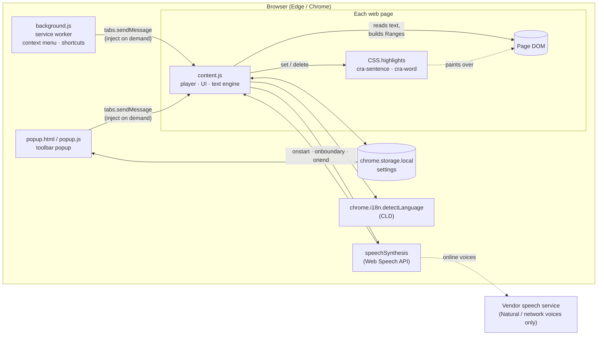
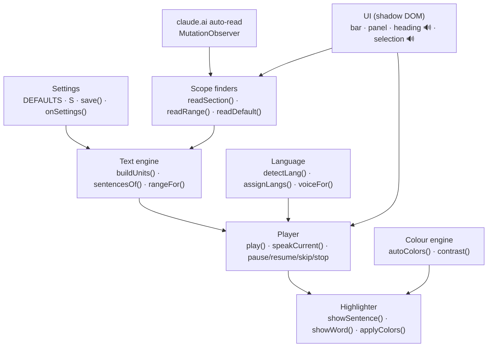
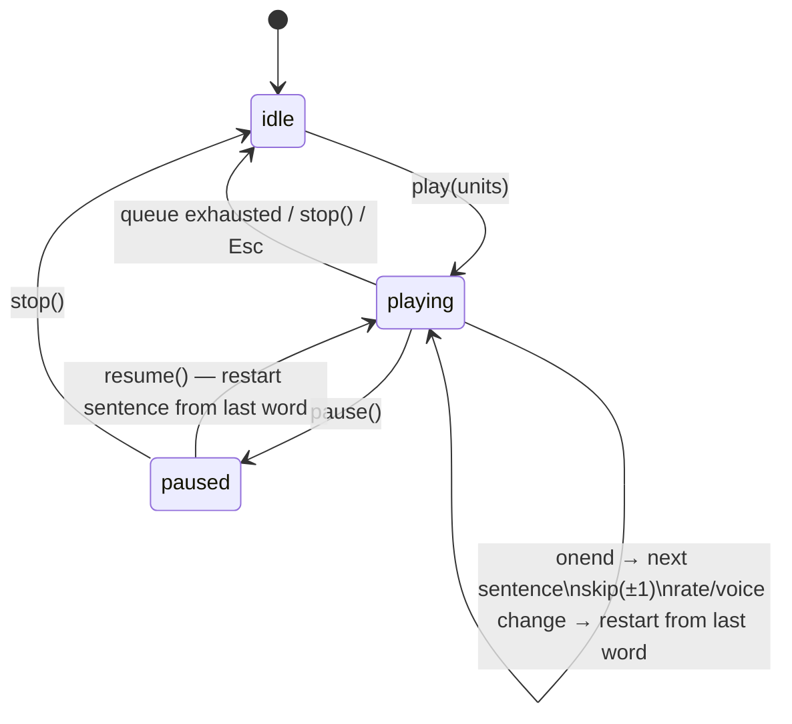
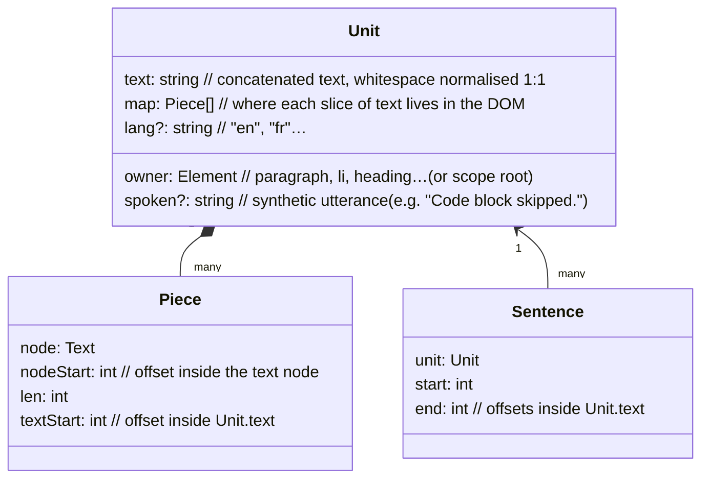

# Architecture

Claude Read Aloud is a Manifest V3 extension with **no backend**. Everything happens in the page: the content script finds text, segments it, drives the browser's `speechSynthesis` engine and paints highlights with the CSS Custom Highlight API.

## Components

| File | Runs in | Responsibility |
|---|---|---|
| `extension/manifest.json` | — | MV3 manifest. Content script on all `http(s)` pages, permissions `storage`, `activeTab`, `scripting`, `contextMenus`, two keyboard commands. |
| `extension/content.js` | Every page (isolated world) | The whole product: text extraction, segmentation, language detection, player state machine, highlighting, on-page UI (player bar, settings panel, heading and selection buttons), auto-read on claude.ai. |
| `extension/background.js` | Service worker | Registers the **Read aloud** context menu and routes the `toggle-reading` / `stop-reading` commands to the active tab. |
| `extension/popup.*` | Toolbar popup | Play/pause, stop, open the settings panel, per-site enable/disable. |

### Why the speech runs in the page, not the popup or service worker

A popup's JavaScript context is destroyed when the popup closes, so speech started there stops (this was the v1.0 bug). MV3 service workers have no `speechSynthesis`, and `chrome.tts` lacks the per-word boundary data needed for highlighting. The content script lives as long as the tab and sits next to the DOM it highlights, so the popup and service worker only **send messages** to it.

If a page loaded before the extension was installed or updated, it has no content script. The popup and service worker then try `tabs.sendMessage`, fall back to `scripting.executeScript({files:["content.js"]})` (allowed by `activeTab`), and resend. A `window.__craLoaded` guard makes injection idempotent, and the listener always calls `sendResponse` so a successful send never triggers a duplicate injection.

## Content script layout

`content.js` is a single IIFE organised in sections:

### On-page UI isolation

All controls live in a single `
` with an **open shadow root**, attached to `<html>`:

- Site CSS can't restyle the controls, and the controls' CSS can't leak into the site.
- `keydown` is stopped at the shadow root, so typing in the settings panel doesn't trigger site shortcuts. claude.ai, for example, focuses its composer on keypress.
- `mousedown` on the bar and floating buttons calls `preventDefault()` so clicking them doesn't clear the user's text selection.
- The host is `position:fixed; 0×0`. Its children use `position:fixed`, so the host itself never covers page content.

Highlight styling (`::highlight(cra-sentence)`, `::highlight(cra-word)`) has to apply to page text, so it goes in a `<style id="cra-hl-style">` in the document head instead.

## Player state machine

State lives in one object `P`:

| Field | Meaning |
|---|---|
| `queue`, `idx` | Sentence items for the current **scope** and the one being spoken. ⏮ / ⏭ move `idx` inside this queue, which is why they never leave the section, reply or selection. |
| `gen` | Generation counter. Every speak, cancel or skip increments it, and each utterance captures its own value. Late `onend` / `onboundary` events from cancelled utterances compare `gen` and are ignored. That's how stale callbacks are prevented. |
| `cur` | `{item, base, text}`. `base` is the character offset inside the unit where the current utterance starts (non-zero after resume). |
| `lastWord` | Absolute offset of the last highlighted word, used to resume or restart mid-sentence. |
| `utt` | Strong reference to the live utterance. Chrome can garbage-collect an unreferenced utterance and never fire `onend`. |
| `voice`, `noBoundary` | Voice in use, and the set of voices observed not to emit word boundaries (enables the timing estimator immediately). |
| `startBlock` | Element that started playback (heading or reply), so its button shows ⏹. |

Only one utterance is ever queued in `speechSynthesis`. The next one is spoken from `onend`. This keeps skip, speed and voice changes immediate and avoids `speechSynthesis.pause()`, which is unreliable with network voices.

## Data model

Because `Unit.text` maps back to text nodes character for character, any `(start, end)` offset converts to a DOM `Range` (`rangeFor`). That conversion is the basis for both highlighting and resuming from a word.

## Settings

`chrome.storage.local` holds a flat object (see `DEFAULTS` in `content.js`). Local rather than sync storage is deliberate: sliders and colour pickers write on every `input` event, which would hit the `storage.sync` write quota (120 per minute). Every tab listens to `storage.onChanged`, so a change made in one tab's panel applies everywhere, including to an utterance already playing (restarted from the current word after a 250 ms debounce).

## Permissions

| Permission | Why |
|---|---|
| content script on `http://*/*`, `https://*/*` | Heading and selection buttons on every site. |
| `storage` | Settings. |
| `activeTab` + `scripting` | Inject the content script into a tab that predates installation, when the user clicks the popup, uses the context menu or presses a shortcut. |
| `contextMenus` | **Read aloud** on right-click. |

No `host_permissions`, no network requests, no remote code.
