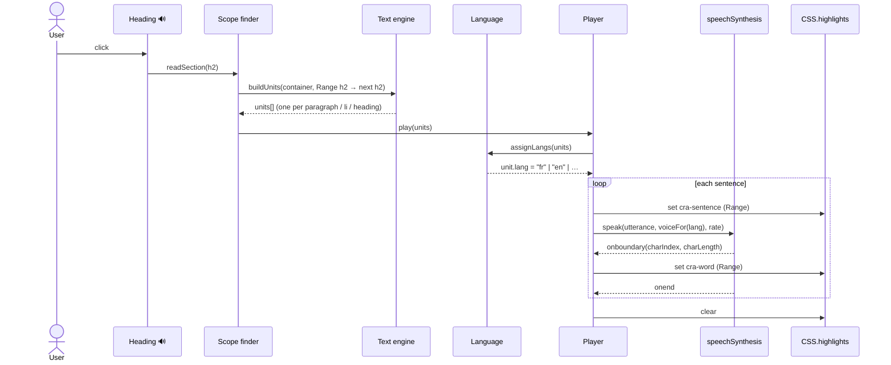

# How it works

This page walks through the main algorithms in `extension/content.js`, in the order they run when you click a 🔊 button.



## 1. Choosing the scope

| Trigger | Scope | Function |
|---|---|---|
| 🔊 on a heading | From the heading up to (not including) the next heading of the **same or higher level** inside the same container. H1 → whole article, H2 → chapter including its H3s, H3 → sub-section. | `readSection` |
| 🔊 on a claude.ai reply | The whole reply. | `play(buildUnits(reply))` |
| 🔊 Read on a selection, right-click, or ▶ with a selection | Exactly the selected range, partial text nodes included. | `readRange` |
| ▶ with nothing selected | Last Claude reply on claude.ai, otherwise the page's `article` / `main`. | `readDefault` |

**Container** = the closest Claude reply, else `article, main, [role=main]`, else `<body>`. Heading levels come from `H1`–`H6` or `role="heading"` + `aria-level`.

The scope is expressed as a DOM `Range`, so the same extraction code serves headings and free selections.

### Page-chrome filtering (`isNoise`)

An element is noise if it sits inside `nav, footer, aside, form, menu`, a navigation, contentinfo, menu or toolbar role, an editable area, or `aria-hidden`. It is also noise if it sits inside a `header` / `role=banner` that is **not** inside an `article` or `main`. That keeps an article's own title header but drops the site masthead. Noise headings get no button, and noise text is dropped when reading a larger container. On claude.ai the filter is bypassed, because everything inside a reply is content.

## 2. Text extraction — `buildUnits(root, range)`

A `TreeWalker` visits every text node under `root` that intersects the range, skipping buttons, SVG, `aria-hidden`, `.sr-only`, form fields and the extension's own host.

Each text node is assigned an **owner**: its closest block element (`p, li, h1–h6, pre, td, th, blockquote, dt, dd, figcaption`) inside `root`. Consecutive nodes with the same owner are concatenated into one **unit**. A new owner starts a new unit, so a heading and the paragraph after it are separate units and the voice pauses naturally between them. Nested lists are also ordered correctly.

While concatenating, each slice is recorded as a `Piece {node, nodeStart, len, textStart}`. Whitespace is normalised **one character for one character** (`\s → " "`), never collapsed, so offsets in `unit.text` stay aligned with the DOM. Markdown symbols are not stripped for the same reason. The page is already rendered HTML, so they're not there anyway.

Code blocks (`pre`) are replaced by a synthetic unit ("Code block skipped." / "Bloc de code ignoré.") unless skipping is off or the scope itself is inside the code block.

## 3. Sentences — `sentencesOf(unit)`

`Intl.Segmenter(…, {granularity: "sentence"})` splits each unit. It's locale-aware and handles abbreviations, decimals and quotes far better than a regex. Leading and trailing spaces are trimmed off each segment's offsets, and segments without any letter or digit are dropped.

Sentences longer than 240 characters are split at the last `, ` / `; ` / `: ` (or space) before the limit. Chrome silently stops long utterances with some voices, and shorter utterances also make ⏮ / ⏭ and speed changes feel responsive.

Each sentence is just `{unit, start, end}`. No text is copied until it's spoken.

## 4. Language and voice

`assignLangs(units)` runs once per `play()`:

1. Detect the language of the whole scope with `chrome.i18n.detectLanguage` (Chromium's CLD). Accept it if `isReliable` or ≥ 70 %.
2. Otherwise fall back to a stop-word and accent score for French vs English (`heuristicLang`).
3. Otherwise use the nearest `lang` attribute, then `"en"`. The attribute comes last because claude.ai always declares `lang="en"`, even for French replies.
4. Every unit of 100+ characters is detected on its own, so a mixed page switches voice per paragraph. Shorter units inherit the scope language, because detection on a few words is unreliable.

`voiceFor(lang)`:

- Default voice if it already matches the language, or if it's a **Multilingual** voice, which handles every language itself.
- For `fr`: the pinned French voice if set.
- Otherwise `bestVoice(lang)`: score = Natural (+4), preferred region (fr-FR; en-US/GB/IE) (+2), Denise or Henri for French (+1), Multilingual (−0.5).

## 5. Speaking — `speakCurrent(fromRel)`

One utterance per sentence item:

```
gen = ++P.gen                          // invalidate any older callbacks
text = unit.text.slice(start + fromRel, end)
utterance.voice/lang/rate/pitch = …
showSentence(item)                     // highlight before audio starts: no visual lag
onboundary → showWord(base + charIndex, charLength)
onend      → idx++, speakCurrent(0)
```

If the engine is still busy (skip or restart), it calls `cancel()` and speaks 60 ms later. Some Chromium builds drop a `speak()` issued in the same tick as `cancel()`.

**Pause** cancels the engine (it does not call `speechSynthesis.pause()`, which is unreliable with network voices) and keeps the highlights. **Resume** speaks the rest of the sentence from `P.lastWord`. Speed, pitch and voice changes while playing restart the same way, so a new speed takes effect within one word.

## 6. Highlighting

The **CSS Custom Highlight API** (`CSS.highlights.set(name, new Highlight(range))`) paints styles over arbitrary `Range`s **without modifying the DOM**:

- It doesn't conflict with React or other frameworks that re-render the page (claude.ai is one).
- It doesn't wrap text in `<span>`s, so it can't break layout, copy and paste, or the site's own scripts.
- Updating is cheap: replace a single `Highlight` object for each sentence or word.

Two highlights are used: `cra-sentence` (background tint) and `cra-word` (solid background plus contrasting text colour, `priority = 1` so it paints over the sentence). `rangeFor(unit, start, end)` walks the unit's piece map to set the range's start and end inside the right text nodes, so a sentence spanning `<b>`, `<a>` or `<code>` highlights seamlessly.

Selected text is deselected when reading starts, because the browser's selection colour would otherwise hide the highlight.

**Follow along**: if the sentence's bounding box is outside the comfortable viewport band, its parent is `scrollIntoView({block:"center"})`'d. This works with nested scroll containers such as claude.ai's chat pane.

## 7. Word tracking

Word highlighting depends on `onboundary` events (`charIndex`, `charLength`):

- **Edge Online (Natural) voices** emit them, so tracking follows the real audio.
- **Many other voices** (e.g. Chrome's Google network voices) emit none.

Fallback: if no boundary arrives within 700 ms of `onstart`, an **estimator** schedules word highlights from `Intl.Segmenter` word positions at ≈ 14.5 characters per second × rate. Once a voice has finished a sentence with no boundaries, it's remembered in `P.noBoundary` and later sentences start the estimator immediately. Any real boundary event cancels the estimator. When `charLength` is missing, the word end is found with a Unicode word regex.

## 8. Auto-contrast colours

For the block being read (`applyColors(el)`), the extension works out:

1. **Background**: the first ancestor with an opaque `background-color`, or white if none. Colours are normalised by painting them onto a 1×1 canvas and reading the pixel back, which handles `rgb()`, `hsl()`, `oklch()`, `color-mix()` and named colours alike.
2. **Text colour**: the block's computed `color`.
3. **Accent**: from a palette for dark backgrounds (amber, cyan, lime, pink, orange) or light ones (blue, magenta, violet, green, rust), the one maximising *contrast with the background + 0.5 × distance from the text colour*.
4. **Sentence tint** = accent at alpha 0.32 (dark) or 0.22 (light), reduced in 0.02 steps until the text colour on the blended tint meets the **WCAG 4.5:1** contrast ratio.
5. **Word** = solid accent, with black or white text, whichever contrasts more.

Results are cached per (background, text) pair, and recomputed per sentence, so a dark code block inside a light page gets its own colours. In manual mode the user's colours are used as-is. The settings panel preview is drawn on the actual reply background.

## 9. Floating buttons

**Heading 🔊**: a capturing `mouseover` listener resolves the hovered heading (or the hovered Claude reply). The button is placed just **after the last line of the heading's text**, measured with `Range.getClientRects()`, because heading elements are usually full-width boxes. It hides 500 ms after the pointer leaves, which leaves time to reach it, and follows scrolling.

**Selection 🔊 Read** is driven by `selectionchange`, not mouse events. It's positioned at the selection's **focus**, the end being extended (a collapsed range at `focusNode/focusOffset`), and clamped inside the viewport. Scrolling away from a half-made selection pins it to the top or bottom edge instead of hiding it, and a Shift+click extension moves it to the new end. It hides only when the selection collapses, is in an editable field, or the site is disabled.

## 10. Auto-read on claude.ai

A `MutationObserver` on `<body>` is debounced to 1.5 s. When the last reply is no longer `data-is-streaming="true"` and its text differs from the last one seen, it's read. Switching conversation (a `pathname` change) resets the baseline instead of reading the old reply, and so does turning Auto on.
